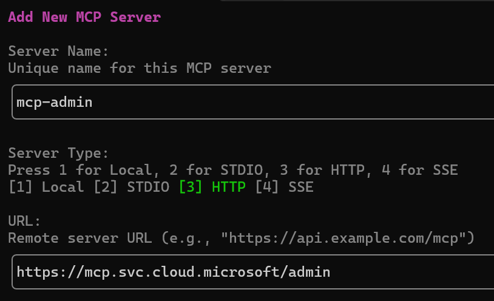
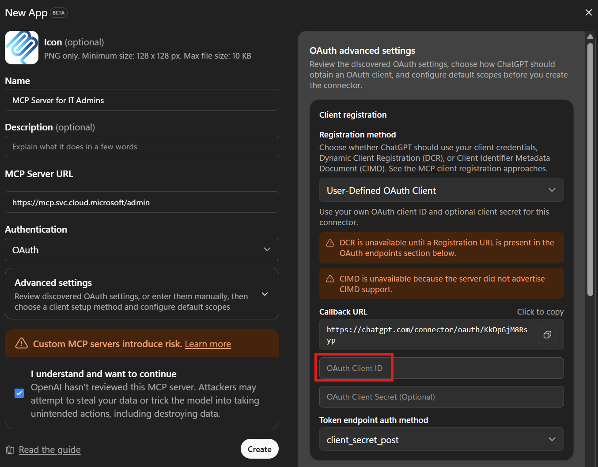
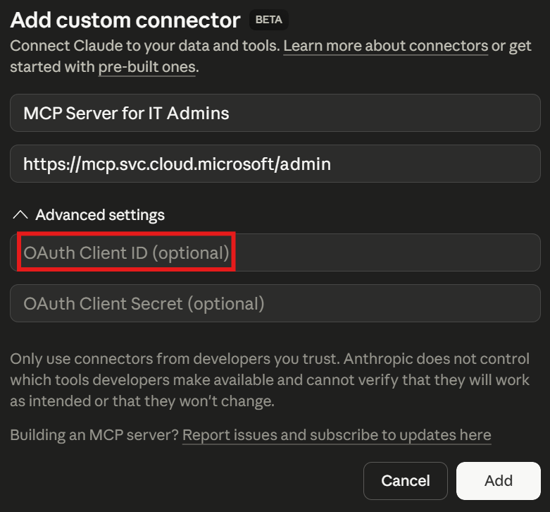

#  Microsoft MCP Server for IT Admins

> [!IMPORTANT]
> **Microsoft MCP Server for Enterprise** (`https://mcp.svc.cloud.microsoft/enterprise`) is **deprecated**. It's now **Microsoft MCP Server for IT Admins** at `https://mcp.svc.cloud.microsoft/admin`, and you must migrate to the new endpoint.
> The `/enterprise` endpoint won't be switched off immediately: you'll have a few months to migrate. See [Migrate from Microsoft MCP Server for Enterprise](#migrate-from-microsoft-mcp-server-for-enterprise).

## Overview

Built on the open [Model Context Protocol](https://modelcontextprotocol.io), **Microsoft MCP Server for IT Admins** lets AI agents read and manage **Microsoft Entra** data, and read **Microsoft Intune** data, by converting natural language requests into Microsoft Graph API calls.
IT administrators and developers use it to query and administer their tenant from AI-powered workflows, with a human confirming every change.

### What's new

1. **Microsoft Graph permissions**: grant your MCP client the Microsoft Graph delegated permissions your scenarios need. Any Graph permission works, except Microsoft 365 APIs, which are covered by [Work IQ MCP](https://learn.microsoft.com/microsoft-365/copilot/extensibility/work-iq/mcp/overview).
1. **Microsoft Intune**: read-only access to Intune APIs, excluding reporting APIs.
1. **Write actions**: tools for `POST`, `PUT`, `PATCH`, and `DELETE` requests. You choose which tools each agent exposes.
1. **Human in the loop**: every write action asks the user for confirmation through [MCP elicitation](https://modelcontextprotocol.io/specification/2026-07-28/client/elicitation).
1. **Request headers**: tools accept Graph request headers as input, such as `If-Match` with an ETag.
1. **Just-in-time access**: the `request_access` tool requests an access package, a PIM role activation, or a new permission grant for the MCP client when the user lacks access.
1. **Simpler setup**: no MCP Server service principal to provision and no PowerShell module. Register an app, add permissions, and grant consent.

## Migrate from Microsoft MCP Server for Enterprise

The `/enterprise` endpoint keeps working for a few months, so you can migrate one client at a time:

1. **Prepare an app registration.** Follow [Register and configure an MCP client](#register-and-configure-an-mcp-client). You can reuse an existing custom app if its redirect URI matches the [Supported clients](#supported-clients) table. The Visual Studio Code default app isn't supported: every client needs your own app registration.
1. **Map your permissions.** For each `MCP.<permission>` scope your client had, add the equivalent Microsoft Graph delegated permission `<permission>`. For example, `MCP.User.Read.All` becomes `User.Read.All`. Also add the three [required permissions](#required-permissions).
1. **Grant admin consent** for the new permissions.
1. **Update the client configuration.** Change the URL to `https://mcp.svc.cloud.microsoft/admin` and set your app's client ID.
1. **Sign in again**, so the client gets a token with the new permissions.
1. **Verify** with a read question, such as *"How many users are in my tenant?"*.
1. **Remove the `/enterprise` server entry** from your clients. After all your clients are migrated, you can revoke the `MCP.*` grants from your app, because the new endpoint doesn't use them.

## Register and configure an MCP client

Each MCP client needs an app registration in your tenant. Dynamic Client Registration (DCR) isn't supported.
Support for Client ID Metadata Documents (CIMD) is coming shortly for third-party clients such as ChatGPT and Claude, and will make the app registration optional for them. Visual Studio Code and GitHub Copilot will still require an app registration.

An administrator completes these steps once per tenant for each client app:

1. **[Register a new app](https://entra.microsoft.com/#view/Microsoft_AAD_RegisteredApps/CreateApplicationBlade/quickStartType~/null/isMSAApp~/false)** representing the MCP client. Under **Supported account types**, select **Accounts in this organizational directory only**.
1. **Add the redirect URI** for your client from the [Supported clients](#supported-clients) table under **Mobile and desktop applications**. Entra then treats the app as a **public client**, so no client secret is needed. Every supported client, including ChatGPT and Claude, connects as a public client.

   Don't add the redirect URI under **Web**: Entra treats Web apps as **confidential clients** and requires a client secret at sign-in.
   The portal doesn't accept `http://127.0.0.1`. To add it, edit `replyUrlsWithType` in the [application manifest](https://learn.microsoft.com/entra/identity-platform/reply-url#prefer-127001-over-localhost).
1. **Add permissions.** Go to **API permissions** > **Add a permission** > **Microsoft Graph** > **Delegated permissions**, and add:
   - The three [required permissions](#required-permissions).
   - The Graph permissions your scenarios need, such as `User.Read.All`, `Group.ReadWrite.All`, `Policy.Read.All`, or `DeviceManagementManagedDevices.Read.All`. See the [Microsoft Graph permissions reference](https://learn.microsoft.com/graph/permissions-reference).
1. **[Grant admin consent](https://learn.microsoft.com/entra/identity/enterprise-apps/grant-admin-consent).** `MCP.Server.Access` and every other permission that requires admin consent need it. Select **Grant admin consent for \<tenant\>** on the **API permissions** page. Alternatively, sign in from the client as an administrator and select **Consent on behalf of your organization**.
1. **Restrict access (optional).** To allow only selected users, open the app in **Enterprise applications**, set **Assignment required?** to **Yes**, and [assign users or groups](https://learn.microsoft.com/entra/identity/enterprise-apps/assign-user-or-group-access-portal).
1. **Configure your client** with the server URL and the app's **Application (client) ID**, as described in [Supported clients](#supported-clients).

Users then sign in with their work account when their client prompts them.

### Required permissions

| Microsoft Graph delegated permission      | Purpose                                                                                       |
| ----------------------------------------- | --------------------------------------------------------------------------------------------- |
| `MCP.Server.Access`                       | Lets the client call Microsoft MCP Server for IT Admins. Requires admin consent.               |
| `User.Read`                               | Signs in the user and reads their profile.                                                     |
| `EntitlementMgmt-SubjectAccess.ReadWrite` | Lets `request_access` request access packages for the signed-in user.                          |

The server advertises these permissions as OAuth scopes prefixed with its URL, and clients that use OAuth discovery request them automatically. If your client asks for scopes, enter:

```text
https://mcp.svc.cloud.microsoft/admin/MCP.Server.Access https://mcp.svc.cloud.microsoft/admin/User.Read https://mcp.svc.cloud.microsoft/admin/EntitlementMgmt-SubjectAccess.ReadWrite
```

Clients don't need to request the other Graph permissions you consented to on the app registration.

### Info Table

| Property                   | Value                                                       | Notes                                                       |
| -------------------------- | ----------------------------------------------------------- | ----------------------------------------------------------- |
| MCP Endpoint               | `https://mcp.svc.cloud.microsoft/admin`                     | Configure in your client                                    |
| MCP Client App Id          | \<The Application (client) ID of your app registration\>    | Required in every client                                    |
| Redirect URI (Reply URL)   | See [Supported clients](#supported-clients)                 | Required on your app registration                           |
| Scopes                     | See [Required permissions](#required-permissions)           | Discovered automatically by most clients                    |
| Token endpoint auth method | `client_secret_post`                                        | Required in some clients, such as ChatGPT; leave the secret empty |
| MCP Server App Id          | `e8c77dc2-69b3-43f4-bc51-3213c9d915b4`                      | Shown in [Microsoft Graph activity logs](#logs); no provisioning needed |

## Supported clients

Microsoft MCP Server for IT Admins works with any MCP client that supports OAuth with a pre-registered client ID.
**Write actions** also require a client that supports elicitation on the latest MCP protocol version, [2026-07-28](https://modelcontextprotocol.io/specification/2026-07-28), which is stateless. In clients without that support, read tools work but write actions are denied. As clients adopt the latest MCP standard, write actions are enabled automatically, with no change on your side.

Add each redirect URI under **Mobile and desktop applications** in your app registration.

| Client                                               | Redirect URI                                              | Write actions                            |
| ---------------------------------------------------- | --------------------------------------------------------- | ---------------------------------------- |
| Visual Studio Code                                   | `http://localhost`                                        | ✅                                       |
| [GitHub Copilot app](https://github.com/github/app)  | `http://127.0.0.1` (add through the manifest)             | ✅                                       |
| GitHub Copilot CLI                                   | `http://127.0.0.1` (add through the manifest)             | ✅                                       |
| Claude Code                                          | `http://localhost/callback`                               | ✅                                       |
| ChatGPT                                              | `https://chatgpt.com/connector/oauth/<random_chars>`      | ✅                                       |
| Claude (claude.ai, desktop, and mobile app)          | `https://claude.ai/api/mcp/auth_callback`                 | ❌ Denied: elicitation not supported yet |

Entra ignores the port when matching `localhost` and `127.0.0.1` redirect URIs, so clients can use dynamic ports.

<details>
<summary><b>Visual Studio Code</b></summary>

1. [Register an app](#register-and-configure-an-mcp-client) with `http://localhost` as the redirect URI under **Mobile and desktop applications**.
1. Run **MCP: Open User Configuration** from the Command Palette and add the server to `mcp.json`, replacing the client ID:

   ```json
   {
     "servers": {
       "mcp-admin": {
         "type": "http",
         "url": "https://mcp.svc.cloud.microsoft/admin",
         "oauth": {
           "clientId": "<REGISTERED_APP_CLIENT_ID>"
         }
       }
     }
   }
   ```

1. Start the server and sign in with an account from your tenant.

</details>

<details>
<summary><b>GitHub Copilot app</b></summary>

1. [Register an app](#register-and-configure-an-mcp-client) with `http://127.0.0.1` as the redirect URI. Add it through the [application manifest](https://learn.microsoft.com/entra/identity-platform/reply-url#prefer-127001-over-localhost).
1. Go to **Customize** > **MCP** > **Add server**, choose **HTTP**, and enter:
   - **Name**: `mcp-admin`
   - **URL**: `https://mcp.svc.cloud.microsoft/admin`
   - **OAuth Client ID**: the client ID of your registered app
1. Select **Sign in** and sign in with an account from your tenant.

</details>

<details>
<summary><b>GitHub Copilot CLI</b></summary>

1. [Register an app](#register-and-configure-an-mcp-client) with `http://127.0.0.1` as the redirect URI. Add it through the [application manifest](https://learn.microsoft.com/entra/identity-platform/reply-url#prefer-127001-over-localhost).
1. Add the server to `~/.copilot/mcp-config.json`, with your app's client ID in `oauthClientId` and `oauthPublicClient` set to `true`:

   ```json
   {
     "mcpServers": {
       "mcp-admin": {
         "type": "http",
         "url": "https://mcp.svc.cloud.microsoft/admin",
         "headers": {},
         "tools": ["*"],
         "oauthClientId": "<REGISTERED_APP_CLIENT_ID>",
         "oauthPublicClient": true
       }
     }
   }
   ```

   You can also run `/mcp add` to enter the connection details interactively, then add `oauthClientId` and `oauthPublicClient` to the new entry:

   

1. Sign in with an account from your tenant when prompted.

For more information, see the [GitHub Copilot CLI documentation](https://docs.github.com/en/copilot/concepts/agents/about-copilot-cli).

</details>

<details>
<summary><b>Claude Code</b></summary>

1. [Register an app](#register-and-configure-an-mcp-client) with `http://localhost/callback` as the redirect URI under **Mobile and desktop applications**.
1. Add the server, replacing the client ID:

   ```bash
   claude mcp add --transport http --client-id <REGISTERED_APP_CLIENT_ID> mcp-admin https://mcp.svc.cloud.microsoft/admin
   ```

1. In Claude Code, run `/mcp`, select `mcp-admin`, and sign in with an account from your tenant.

</details>

<details>
<summary><b>ChatGPT</b></summary>

1. Go to **Settings** > **Apps** > **Create App**, enter the **Name** and **MCP Server URL**, select **OAuth** authentication, and open **Advanced settings**.
1. Under **Registration method**, select **User-Defined OAuth Client** and copy the **Callback URL**.
1. [Register an app](#register-and-configure-an-mcp-client) with the callback URL as the redirect URI under **Mobile and desktop applications**.
1. Enter the client ID in the red box and leave **OAuth Client Secret** empty. Keep `client_secret_post` as the **Token endpoint auth method**.

   

1. Confirm the risk notice, select **Create**, and sign in with an account from your tenant.

</details>

<details>
<summary><b>Claude (claude.ai, desktop, and mobile app)</b></summary>

> **Note:** Claude.ai, Claude Desktop, and the Claude mobile app don't support MCP elicitation yet, so write actions are denied and only read tools work. For write actions, use [Claude Code](#supported-clients).

1. [Register an app](#register-and-configure-an-mcp-client) with `https://claude.ai/api/mcp/auth_callback` as the redirect URI under **Mobile and desktop applications**.
1. Go to **Customize** > **Connectors**, select **+** > **Add custom connector**, and enter the **Name** and **URL**.
1. Open **Advanced settings**, enter the client ID in the red box, and leave the client secret empty:

   

1. Save the connector, select **Connect**, and sign in with an account from your tenant.

</details>

## Tools

This MCP Server uses Retrieval-Augmented Generation (RAG) and few-shot prompting to generate complete Microsoft Graph queries, rather than exposing a separate tool per Graph operation.
It exposes these tools:

| Tool                              | Description                                                                                                         |
| --------------------------------- | ------------------------------------------------------------------------------------------------------------------- |
| `microsoft_graph_suggest_queries` | Finds relevant Microsoft Graph API calls based on user intent.                                                      |
| `microsoft_graph_get`             | Runs read-only Microsoft Graph API calls.                                                                           |
| `microsoft_graph_list_properties` | Retrieves the properties of specific Microsoft Graph entities to help the AI model build accurate queries.          |
| `microsoft_graph_post`            | Creates resources or invokes actions with Microsoft Graph `POST` requests.                                           |
| `microsoft_graph_put`             | Creates or replaces resources with Microsoft Graph `PUT` requests.                                                   |
| `microsoft_graph_patch`           | Updates resources with Microsoft Graph `PATCH` requests.                                                             |
| `microsoft_graph_delete`          | Deletes resources with Microsoft Graph `DELETE` requests.                                                            |
| `request_access`                  | Requests missing access: an access package assignment, a PIM role activation, or a new permission grant for the MCP client. |

- **Confirmation**: write tools (`post`, `put`, `patch`, and `delete`) ask the user to confirm through elicitation before calling Microsoft Graph. If the client doesn't support elicitation on MCP 2026-07-28, the write action is denied.
- **Tool selection**: enable only the tools your agent needs. For example, an agent that onboards users can use `microsoft_graph_post` and `microsoft_graph_patch` with `User.ReadWrite.All`, without `microsoft_graph_delete`. Tool selection narrows what an agent can do; it never grants more than the app's Graph permissions and the user's roles allow.
- **Request headers**: tools accept Microsoft Graph request headers, such as `If-Match` with an ETag for safe concurrent updates, or `ConsistencyLevel` for advanced queries.
- **Request access**: `request_access` follows your existing policies: access package approvals, PIM activation settings, and consent settings still apply.

## Current scope and capabilities

The MCP Server supports enterprise IT scenarios in **Microsoft Entra** identity and directory operations (users, groups, applications, devices, and administrative actions), with read and write support, and in **Microsoft Intune**, read-only.
Microsoft 365 APIs, such as mail, files, and Teams, aren't supported: use [Work IQ MCP](https://learn.microsoft.com/microsoft-365/copilot/extensibility/work-iq/mcp/overview) instead.

The MCP Server handles requests such as:

1. **Security posture**: authentication methods/strengths, Conditional Access, Security Defaults.
1. **Privileged access**: who has which directory roles, how they're assigned (direct vs group), and PIM status.
1. **Application risk**: which Apps / Service Principals exist, who owns them, what permissions/SSO they use, and which are ownerless or external.
1. **Access governance**: who has access to what (users, groups, packages); review decisions, automate joiner/mover/leaver.
1. **Device readiness**: managed/compliant status, join state, OS/version distribution, stale or inactive devices, and Intune device and policy data.
1. **Provenance and investigation**: end‑to‑end telemetry (sign‑in, audit, provisioning, network), health alerts, and SLA/availability.
1. **Optimize spending & hygiene**: license counts/usage, unused or stale apps/groups, domain configuration and contacts.
1. **Administration**: create, update, and delete users, groups, applications, and other directory objects, with a confirmation before each change.

## Authorization and permissions

Microsoft MCP Server for IT Admins supports **delegated permissions only**. A request succeeds only if both the MCP client's consented Graph permissions and the signed-in user's permissions and roles allow it. Consent doesn't grant access beyond that user's authorization.

You control access in layers:

1. **App permissions**: grant only the Microsoft Graph permissions your use cases need. For a read-only configuration, grant only read permissions. Add permissions as your needs change.
1. **User roles**: the user's Entra roles and permissions still apply, including PIM activation.
1. **User assignment**: with **Assignment required?** set to **Yes**, only assigned users and groups can sign in to the MCP client.
1. **Tool selection**: each client or agent exposes only the tools you enable.
1. **Confirmation**: users confirm every write action before it runs.

When a user lacks access, the agent can call `request_access` to start the access request. The request still follows your approval, PIM, and consent policies.

## Troubleshooting

| Symptom                                                                 | Cause and fix                                                                                                                                                                                              |
| ----------------------------------------------------------------------- | ---------------------------------------------------------------------------------------------------------------------------------------------------------------------------------------------------------- |
| `AADSTS50011`: redirect URI mismatch                                    | Add your client's redirect URI from the [Supported clients](#supported-clients) table under **Mobile and desktop applications**. Add `http://127.0.0.1` through the manifest.                            |
| `AADSTS7000218`: request body must contain `client_assertion` or `client_secret` | The redirect URI is under **Web**, so Entra expects a secret. Move it to **Mobile and desktop applications**.                                                                                   |
| `AADSTS65001`: consent required                                         | [Grant admin consent](#register-and-configure-an-mcp-client) for `MCP.Server.Access` and the other permissions that require it.                                                                         |
| `AADSTS50105`: user not assigned                                        | **Assignment required?** is set to **Yes** and the user isn't assigned. Assign the user or one of their groups to the app.                                                                                 |
| Invalid scope error                                                     | The client still uses the old configuration (`api://e8c77dc2-69b3-43f4-bc51-3213c9d915b4/.default` or `MCP.*` scopes). Remove the server, add it again with the `/admin` URL, and sign in again.         |
| Microsoft Graph returns `403 Forbidden`                                 | The app lacks the Graph permission, or the user lacks the role. Add the permission and grant consent, activate the role in PIM, or let the agent call `request_access`.                                    |
| Write action denied, or no confirmation prompt                          | The client doesn't support elicitation on MCP protocol version 2026-07-28. Use a client that supports write actions in the [Supported clients](#supported-clients) table.                                 |

## Advantages

1. **Remote MCP Server**: easy to configure and standards-compliant, deployed in the same regions as Microsoft Graph.
1. **IT Admins in control**: standard Microsoft Graph permissions, admin consent, user assignment, and tool selection decide what each agent can do.
1. **Human in the loop**: users confirm every write action before it runs.
1. **Simplified architecture**: 8 tools cover the workflow instead of one tool per API operation.
1. **High-quality query generation**: generates accurate queries from over 500 real-world examples via RAG (Retrieval-Augmented Generation).
1. **Full auditability**: all MCP operations run under the same App ID with a specific user agent.
1. **No extra license required**: your existing Microsoft Entra, Microsoft Intune, and Microsoft Graph API licenses apply.

## Availability, Roadmap and feedback

Microsoft MCP Server for IT Admins is available only in the public cloud (global service), with support for sovereign clouds planned for a future release.
We will continue expanding beyond the current Microsoft Entra and Microsoft Intune scenarios, but Microsoft 365 APIs are covered by [Work IQ MCP](https://learn.microsoft.com/microsoft-365/copilot/extensibility/work-iq/mcp/overview).
Please share suggestions or issues through our feedback form: [Submit feedback](https://aka.ms/MCPServerForEnterpriseSurvey).

## Licensing and usage

- Microsoft MCP Server for IT Admins **doesn't require extra cost or separate license**.
- You need the right licenses for the data you access (for example, Microsoft Entra ID Governance or Microsoft Entra ID P2 license for Privileged Identity Management (PIM) data).
- Any request to this MCP server is limited to **100 requests per minute per user**. Tools that call Microsoft Graph are also subject to [Microsoft Graph throttling limits](https://learn.microsoft.com/graph/throttling-limits).

## Logs

To monitor usage, enable [Microsoft Graph activity logs](https://learn.microsoft.com/graph/microsoft-graph-activity-logs-overview) in your tenant to record the Graph API calls made through the MCP server.

**Filter for MCP Server usage:**

Use the Application (Client ID) of Microsoft MCP Server for IT Admins: `e8c77dc2-69b3-43f4-bc51-3213c9d915b4`.

The following Kusto query retrieves these logs:

```kusto
MicrosoftGraphActivityLogs
| where TimeGenerated >= ago(30d)
| where AppId == "e8c77dc2-69b3-43f4-bc51-3213c9d915b4"
| project RequestId, ClientRequestId, TimeGenerated, UserId, RequestMethod, RequestUri, Scopes, ResponseStatusCode
```

Use Graph's `RequestId` and `ClientRequestId` with the timestamp, user, and request URI to trace API calls. Filter on `RequestMethod` to review write operations. `Scopes` lists permissions in the Graph access token, not the specific permission used to authorize each operation.

## Security and compliance

All operations respect Microsoft Graph permissions and security policies, and every write action requires the user's confirmation.
The MCP server uses standard Microsoft Graph telemetry and doesn't log request payloads. Review your AI client's data-handling and retention policies for prompts and returned data.
Ensure compliance with your organizational, regulatory, and contractual requirements when integrating the MCP Server.

## No warranty/limitation of liability

This software is provided "as is" without warranties or conditions of any kind, either express or implied. Microsoft isn't liable for any damages that result from use, misuse, or misconfiguration of this software.
